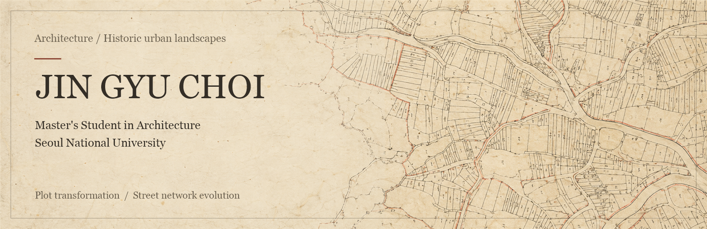

## About

**서울대학교 건축학과 석사과정**

역사도심경관계획을 중심으로, 필지와 가로의 변화과정에 관심을 두고 있습니다.

## Research interests

| 연구 관심사 | Research focus |
| :--- | :--- |
| **역사도심경관계획** | Historic Urban Landscape Planning |
| **필지의 변화** | Plot Transformation |
| **가로의 변화과정** | Street Network Evolution |

<!-- The decorative banner is an original generated antique cadastral-map motif, not a reproduction of a real historical map or research evidence. -->
