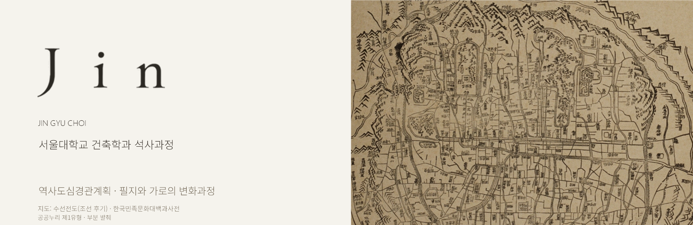

## About

**서울대학교 건축학과 석사과정**

역사도심경관계획을 중심으로, 필지와 가로의 변화과정에 관심을 두고 있습니다.

## Research interests

| 연구 관심사 | Research focus |
| :--- | :--- |
| **역사도심경관계획** | Historic Urban Landscape Planning |
| **필지의 변화** | Plot Transformation |
| **가로의 변화과정** | Street Network Evolution |

## Map source

배너 배경은 조선 후기 서울 지도 **수선전도(首善全圖)**의 일부입니다.

- 출처: [수선전도 - 한국민족문화대백과사전, 한국학중앙연구원](https://encykorea.aks.ac.kr/Article/E0031458)
- 이용 조건: **공공누리 제1유형(출처 표시)**
- 편집: 지도 비율을 유지하여 일부 발췌·크기 조정, 소개문 병치
- [제공 이미지 원본 보기](./suseon-jeondo-original.png) · [출처 및 편집 내역](./SOURCE.md)

※ 수선전도는 서울의 도성도이며, 필지별 지적도가 아닙니다.
